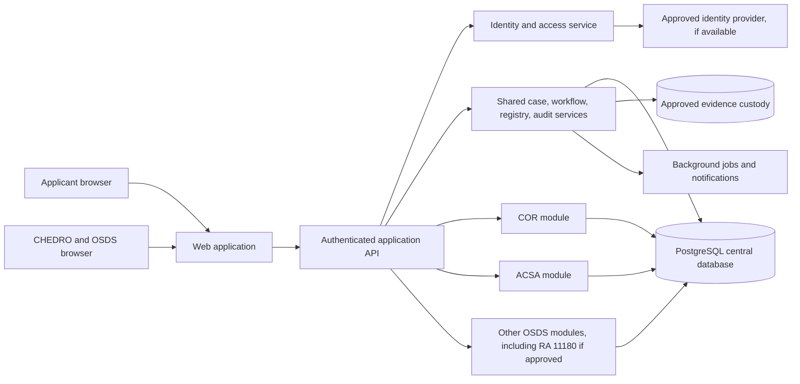
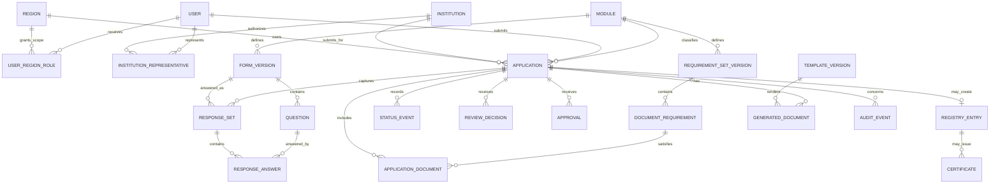

# OSDS Management Platform: preliminary requirements and architecture

**Status:** Review draft, updated 13 October 2026. This document interprets preliminary meeting notes, two supplied images, linked artifacts, and two overlapping, partial machine-generated meeting transcripts. The [technical specification](./OSDS_TECHNICAL_SPECIFICATION.md) refines this report around the preferred Laravel stack and inventories five candidate Office templates. Neither document is an approved CHED policy or authorization for production implementation.

## 1. Scope and evidence

The proposed platform covers Certificate of Recognition (COR) and Authority to Conduct Sports Activities (ACSA), with RA 11180 reporting priority now requiring an explicit first-release decision. It should support other OSDS programs and regional variations without assuming they all use the same questionnaire or workflow. A supplied CHED-branded process graphic adds detail to the preliminary COR/ACSA path. A second supplied image lists **proposed** RA 11180 data-collection enhancements. Neither image establishes an approved policy or final software scope. The linked Google artifacts could not be inspected in this environment because their content was inaccessible or required Google sign-in/cookies; their names and URLs do not verify their contents.

### Evidence and access register

| Source | What can be established here | Limit |
| --- | --- | --- |
| Initial meeting notes | Requested capabilities and preliminary five-step COR/ACSA path | No signed-off requirements or process authority supplied |
| [First meeting transcript](<C:/Users/LocalUser.LAPTOP-MGEP8F46/.codex/attachments/2c93d49a-d3cd-44c3-9076-273efdd5bcdb/Pasted text.txt>) | Participants discussed the applicants, existing Google Forms/Sheets/Script prototype, CHEDRO validation, certificate preparation, nationwide recognition lookup, evidence handling, access, hosting, and requirements sign-off. RA 11180 reporting was described as urgent alongside COR/ACSA. | Machine transcription contains uncertain names/acronyms and ends mid-sentence; it records discussion, not an approved decision or full meeting. |
| [Second meeting transcript](<C:/Users/LocalUser.LAPTOP-MGEP8F46/.codex/attachments/10b1739a-2697-43a1-83cf-abee52dd4868/Pasted text.txt>) | Repeats the first transcript's requirements/hosting discussion, then describes the existing RA 11180 collection system, regional exports, template-upload errors, migration question, interim process, capacity planning, and iterative development. | Has timestamps but overlaps the first excerpt and ends mid-discussion around 24:44; transcription varies on names, acronyms, and security authority. Do not count repeated statements as separate decisions. |
| Supplied COR/ACSA process image | Five displayed steps and durations: online application (1 day); CHEDRO receipt, initial screening and checklist validation (5 days); central registry entry and certificate preparation for Regional Director signature (1 day); email schedule notice (1 day); collection of signed undertaking and certificate issuance (1 day). Displayed sum: nine days. | The image does not establish working versus calendar days, pauses, formal approval rules, or whether both modules always have identical rules. |
| Supplied “Proposed Data Collection Enhancements for RA 11180” image | A proposal for HEI submission, regional validation/correction, Central Office consolidation, centralized data, automated anomaly detection, dashboard, and simpler interface | It explicitly says initial features for technical validation and prioritization; it is not a committed MVP or approved RA 11180 workflow. |
| [COR/ACSA application Google Form](https://forms.gle/Q8ofLDEPQ7MC5ZtX9) and [automated certificate Google Form](https://forms.gle/ujHKGiPWty2kXcYG9) | Links were supplied as current-process artifacts | Questions, required fields, branching, permissions, and response destinations could not be inspected. |
| [ACSA certificate presentation](https://docs.google.com/presentation/d/1s-xgF4HjaRpepTo0qe0CEOfOFlFisZgHbIid23VRa84/edit?usp=sharing) and [COR certificate presentation](https://docs.google.com/presentation/d/1WkUupHT_zQcFwio4tTQr5bcBE9TmEYmxoPH7T1b9Sb8/edit?usp=sharing) | Links identify separate candidate template artifacts | Wording, merge fields, numbering, signature blocks, and approved status could not be inspected. |
| [Certificate Apps Script](https://script.google.com/u/0/home/projects/1xao3n095fT_7aNzdPKM7hUabI2Vms2IIBd0yTfm3-p4R3fvM4dOTAlS2/edit) and [downloadable forms folder](https://drive.google.com/drive/folders/1E9bbuab21MnHT4awd5RLoREsZ7sFRrx4?usp=sharing) | Links identify code and documents to inventory | Script logic, integrations, forms, data stores, and ownership could not be inspected. |
| RA 11180 academic-year links | [AY 2022–2023](https://sites.google.com/ched.gov.ph/ra11180portal/home), [AY 2023–2024](https://sites.google.com/ched.gov.ph/ra11180portal2024), [AY 2024–2025 RSC page](https://sites.google.com/ched.gov.ph/ra11180portal2025), [AY 2024–2025 HEI link](https://bit.ly/2025chedsportsreport), [AY 2025–2026 RSC page](https://sites.google.com/ched.gov.ph/ra11180portal2026), and [AY 2025–2026 HEI link](https://bit.ly/2026chedsportsreport) were supplied. They suggest year-specific entry points and RSC/HEI audiences. | Page contents, questionnaires, datasets, roles, and live operation could not be verified. “RSC” is not expanded or assigned a system role here. |

The linked artifacts should be reviewed in a CHED-authorized account or provided as controlled exports. For each, capture owner, last approved version, audience, fields, validation, data destination, and whether it is still in use. Do not copy live applicant responses into a development environment.

### Downloaded Office templates: candidate artifacts

Five blank templates were inspected; their applicability to COR, ACSA, or both is **unconfirmed**. The [technical specification](./OSDS_TECHNICAL_SPECIFICATION.md) records their fields and proposed data implications in detail.

| Template | Observed contents | Clarification |
| --- | --- | --- |
| [CERTIFICATE OF UNDERTAKING.docx](<C:/Users/LocalUser.LAPTOP-MGEP8F46/Downloads/drive-download-20261013T032242Z-1-001/CERTIFICATE OF UNDERTAKING.docx>) | Athletic association undertakings, officers' signatures, date/place, notarial section | References a 2026 CHED memorandum without its number; verify wording, signatures, notarization, and module use. |
| [INSURANCE COVERAGE.docx](<C:/Users/LocalUser.LAPTOP-MGEP8F46/Downloads/drive-download-20261013T032242Z-1-001/INSURANCE COVERAGE.docx>) | Institution/representative; insurer, policy, period, amount, coverage, funding, and insured-athlete list | Confirm whether details are uploaded, entered as data, or both; protect athlete information. |
| [LIST OF COACHES & TECHNICAL OFFICIALS_.xlsx](<C:/Users/LocalUser.LAPTOP-MGEP8F46/Downloads/drive-download-20261013T032242Z-1-001/LIST OF COACHES & TECHNICAL OFFICIALS_.xlsx>) | Association/date and columns for coach, sport, HEI, employment, position, email | Instruction requests contact number but header lacks the column; clarify technical-official fields. |
| [LIST OF MEMBER HEIs.xlsx](<C:/Users/LocalUser.LAPTOP-MGEP8F46/Downloads/drive-download-20261013T032242Z-1-001/LIST OF MEMBER HEIs.xlsx>) | Association/date/preparer and HEI type, region, contact person, position, email, phone | Confirm whether this is a dated submission snapshot or a maintained membership registry. |
| [SAP-Calendar of Activities Template.docx](<C:/Users/LocalUser.LAPTOP-MGEP8F46/Downloads/drive-download-20261013T032242Z-1-001/SAP-Calendar of Activities Template.docx>) | School year, activity/sport, participants, HEI/association, schedule, venue, focal contact, signature lines | Confirm SAP meaning, module use, and whether schedule revisions must be preserved. |

For each template, obtain the document owner's approved version and decide whether completed files are evidence uploads, structured entries, or both. Do not convert template instructions into system-enforced policy without approval.

### First 30 minutes of meeting: findings to validate

The transcript is imperfect, so the entries below are **attributed meeting statements**, not final CHED rules.

| Topic | What the discussion indicates | Decision still needed |
| --- | --- | --- |
| Applicant and case types | Athletic associations seek recognition; a separate application is discussed for authority to conduct sports activities involving students. HEIs and associations were mentioned as activity applicants. | Confirm who may apply for each certificate, whether COR is a prerequisite for ACSA, and the exact legal names of both outputs. |
| Regional/national associations | A speaker distinguished regional associations handled by CHEDRO from national associations handled by Central Office. | Approve jurisdiction and routing rules, including cases spanning regions. |
| Existing prototype | Google Forms collect application details, checklist items, and files; a second CHEDRO form and Apps Script generate draft certificates. The presenter said the templates and automation were not final. | Obtain the actual field/export/script inventory and approved template versions; do not copy prototype behavior blindly. |
| Certificate metadata | Presenter described serial number, date, validity reminder, region, and region director populated on a sample certificate. | Confirm numbering, date meaning, validity rules, signatory mapping, and which values are official. |
| Recognition lookup | An HEI should be able to check recognized athletic associations across the Philippines, including associations from other regions. | Decide searchable fields, eligibility of users, freshness, public/private visibility, and treatment of suspended/expired recognition. |
| Evidence handling | One participant favored individual **file links** rather than storing uploads in the system; another stressed that some physical/notarized documents may still be required. | Choose approved evidence custody: private platform storage, external file links, or a controlled hybrid; prohibit folder links if file-link mode is chosen; confirm physical-original handling. |
| Status and oversight | School, CHEDRO, and Central Office should see relevant application/document status; a speaker raised cases stalled in a region or forwarded to another office. | Approve routing, ownership, handoff, escalation, and who sees what detail. |
| Accounts | School enrollment through an identified focal person was discussed; athletic directors/sports coordinators and association secretariats were mentioned as examples. | Confirm identity proof, representation, who provisions accounts, and whether associations use SCHOOL accounts or a separate organization subtype. |
| RA 11180 | Sports reportorial data was called urgent in the meeting, alongside student-athlete protection and COR/ACSA. | Decide whether RA 11180 is part of the first release, a parallel workstream, or a later module. |
| Governance and deployment | A participant requested a signed user requirements analysis before development, asked where the system would be hosted, and described DICT security testing/clearance for an external-facing deployment. DigitalOcean was mentioned as a possible environment. | Confirm required sign-off, approved host, actual DICT review requirement, security owner, and deployment gate. Do not treat the meeting statement as a verified regulation. |

The legal reference was transcribed uncertainly as “RA 11184 ... sorry, 80.” CHED's published [RA 11180 implementing rules](https://legacy.ched.gov.ph/rules-and-regulations-to-implement-the-provisions-of-republic-act-no-11180-athletic-programs-report-act/) identify RA 11180 as the Athletic Programs Report Act. The separate “MO 13” reference in the transcript is not sufficiently clear to assign an order number, year, or applicability.

### Second excerpt: additional findings to validate

The second excerpt overlaps the first for roughly its opening five minutes. Its later statements add the following; none is a signed-off requirement.

| Topic | What the discussion indicates | Decision still needed |
| --- | --- | --- |
| Existing RA 11180 system | Participants described an existing OPRKM-hosted collection system with regional sports-coordinator access and an access-level setting. A user reported downloading data region by region, limited consolidated/raw-data access, download errors, and no useful status view. | Inventory the actual system, owners, database/export formats, permissions, source code/support status, and whether reported limitations still exist. |
| RA 11180 questionnaire | Participants described downloadable templates, approximately eight sheets, HEI upload, differing question interpretations, and consolidation errors. The questionnaire was being reviewed/recalibrated. | Obtain the sheets and current approved questions; decide structured entry versus file import and validation rules. Do not hardcode the present sheet layout. |
| Legacy data | Speakers debated importing existing Google Forms/RA 11180 data versus starting new because extraction and quality were difficult. No final migration decision was recorded. | Decide historical data retention, migration scope, source of truth, cleansing, reconciliation, and access to prior reports. |
| Interim operation | A speaker suggested Google Form or manual submission while the new system is developed. A January deadline and August–December 2026 development window were mentioned. | Confirm the actual reporting deadline, transitory policy, owner of interim records, and whether/when they enter the new platform. |
| Capacity and support | A participant cited roughly 3,000 schools as a planning scale and simultaneous logins as a concern; others raised next-year maintenance and loss of knowledge about the existing system. | Obtain real school/user counts and concurrency expectations; assign operational owner, documentation, and support after handover. |
| Development method and launch | Participants favored iterative design/coding/testing/documentation, while repeatedly saying an external-facing system needs a security assessment before deployment. The two transcripts transcribe the authority differently (“DICT” versus “ICT”). | Confirm delivery milestones, actual approving authority, VAPT scope/evidence, hosting owner, and launch gate. Do not assume a particular agency clearance from this transcript. |

**Classification used below:**

- **Confirmed in notes (unverified):** Explicitly requested in the notes. This confirms the planning intent, not an approved business rule.
- **Observed in supplied image:** Visible process detail in the user-provided graphic, still requiring process-owner confirmation.
- **Observed in supplied template:** Visible field or instruction in a supplied blank Office file, without proof of current approval or module applicability.
- **Discussed in partial transcript:** A participant described or requested it during the recorded discussion; not a signed-off requirement.
- **Proposed in supplied image:** A feature explicitly presented for technical validation and prioritization, not a committed requirement.
- **Supervisor-confirmed, provisional:** A clarification the user confirmed with their supervisor, pending final stakeholder approval.
- **Design inference:** A proposed capability needed to make the recorded requirements workable. It needs validation during discovery.
- **Clarification required:** A policy, process, ownership, or scope decision that cannot safely be inferred.

### Requirements register

| Area | Classification | Current interpretation or decision needed |
| --- | --- | --- |
| Initial modules | Confirmed in notes (unverified) | COR and ACSA were the initial focus in the notes; the partial meeting transcript also calls RA 11180 reporting urgent. Approve release sequencing before fixing MVP scope. |
| Accounts and access | Confirmed in notes (unverified) | Secure login, role-based access, region-aware users and applications. Exact roles and rights require approval. |
| Account types | Supervisor-confirmed, provisional | Five account types in the stated hierarchy: Super User, Admin, OSDS, CHEDRO, SCHOOL. Whether hierarchy means account creation authority, visibility, permission inheritance, or all three remains open. |
| Submission | Confirmed in notes (unverified) | Applicants submit online applications and supporting requirements. Identity and institutional authority need definition. |
| CHEDRO review | Confirmed in notes (unverified) | CHEDRO receives, screens, and validates submissions. The meaning of each action and who may perform it require definition. |
| Registry | Confirmed in notes (unverified) | Central registry is searchable; CHEDRO registers the applicant. Clarify whether registry entry occurs before approval, after validation, or at issuance. |
| Questionnaires | Confirmed in notes (unverified) | Forms, questionnaires, requirement checklists, and shareable links are configurable. Public versus authenticated link behavior is undecided. |
| Status and documents | Confirmed in notes (unverified) | Track status and validation; manage official letters, certificates, and documents. Exact status names, legal forms, and signing authority are undecided. |
| Reporting | Confirmed in notes (unverified) | Dashboards, reports, and exports. Metrics, access scope, and export formats require definition. |
| Audit/security | Confirmed in notes (unverified) | Audit trails and secure document handling. Retention, classification, and incident procedures require policy input. |
| Human decisions | Confirmed in notes (unverified) | Preserve human validation, official approvals, signatures, and issuance where required. A generated file is not evidence of approval or issuance. |
| COR and ACSA relationship | Clarification required | No prerequisite or sequencing rule is established. Treat them as independent modules until confirmed. |
| Nine-day duration | Clarification required | The supplied graphic displays 1 + 5 + 1 + 1 + 1 = 9 days. Start/stop events, working-day rules, pauses, and module applicability remain unconfirmed. Do not implement an SLA yet. |
| Regional Director signature preparation | Observed in supplied image | The graphic says CHEDRO generates the COR/ACSA certificate for the Regional Director’s signature. Confirm actual signatory, delegation, review, and signature/issuance controls. |
| RA 11180 reporting capability | Proposed in supplied image | HEI submission, CHEDRO validation, Central Office consolidation, anomaly detection, and dashboards are proposed capabilities of a separate module; release priority is unresolved. |
| RA 11180 release priority | Discussed in partial transcript | A participant called sports reporting urgent. Decide whether it joins the first release, runs in parallel, or remains later; the earlier future-module assumption is no longer safe. |
| Applicant organization types | Discussed in partial transcript | Both schools and athletic associations were discussed, with possible national/regional differences. Confirm exact eligibility and account mapping. |
| Nationwide recognition lookup | Discussed in partial transcript | HEIs should be able to check recognized associations across regions; limit lookup to approved registry fields and statuses. |
| Evidence custody | Discussed in partial transcript | A speaker preferred individual file links; others discussed uploads and some physical originals. Storage mode and verification controls require a decision. |
| Legacy RA 11180 system | Discussed in partial transcript | An existing OPRKM collection system was described with regional exports and limited central consolidation/status. Inventory it before choosing rebuild or migration. |
| Capacity and launch | Discussed in partial transcript | Approximately 3,000 schools, simultaneous use, a January deadline, and prelaunch security testing were mentioned. Validate volumes, dates, and authority before commitments. |
| Five Office templates | Observed in supplied template | They suggest association, member HEI, personnel, insurance, athlete, and activity data, but do not establish required fields or COR/ACSA applicability. |
| Shared workflow engine | Design inference | A small configurable state/transition service may help, but module-specific business logic must remain possible. |
| Notifications | Design inference | Notifications are needed for applicant updates and scheduling, but channels, wording, and official delivery rules need approval. |

### Missing business rules and exceptions to resolve

1. **Eligibility and identity:** Who may apply, whether one account can represent multiple institutions, proof of authority, duplicate institution handling, and whether existing registry identifiers are reused.
2. **Jurisdiction:** Which region owns an application; whether it follows institution address, event venue, applicant location, or another rule; who can transfer cases; and who can view national data.
3. **Application lifecycle:** Allowed states and transitions for each module; who can submit, return for correction, withdraw, reject, reopen, cancel, or archive; whether resubmission creates a revision or new case.
4. **Screening and validation:** Difference between completeness screening and substantive validation, mandatory evidence, checklists, deadlines, and whether a second reviewer is required.
5. **Approval and signature:** Named authorities, delegation rules, sequence, whether digital signatures are valid, and how signed paper documents are recorded. These must come from authorized process owners.
6. **Registry and numbering:** What a registry record means; when a certificate number is reserved or assigned; uniqueness and numbering rules; replacement, correction, revocation, and expired certificates.
7. **Undertaking and issuance:** Whether every module requires an undertaking; who schedules and records it; whether certificate issuance is in person, electronic, or both; and acceptable proof of receipt.
8. **ACSA-specific rules:** Eligibility, event or activity details, validity period, supporting documents, repeat applications, and any link to COR.
9. **Form/link behavior:** Whether questionnaires are application forms or standalone surveys; who can publish links; anonymous use, expiry, single-use limits, and data ownership.
10. **Operational exceptions:** Missing or corrupted uploads, duplicate applications, wrong-region submissions, staff reassignment, approver absence, document correction, system outage, and disputes or appeals.
11. **Records and reporting:** Retention and disposal schedules, legal hold, export approval, public verification needs, and required report definitions.
12. **Current artifacts:** Obtain controlled copies of both Google Forms, both certificate presentations, the Apps Script project, and downloadable forms. Map each field, checklist item, merge variable, script trigger, output location, access grant, and manual step before replacement or migration.
13. **RA 11180 scope:** Confirm the program owner, reporting basis, academic-year cycle, RSC meaning and duties, HEI access rules, regional validation criteria, Central Office powers, duplicate definition, and whether historical reports need migration. Keep this discovery separate from COR/ACSA acceptance.
14. **Five-tier access:** Define each account type's creation and approval authority, module and region scope, actions, export rights, support access, and whether users may hold multiple types. Confirm whether the displayed order conveys reporting structure, provisioning authority, or any permission inheritance.
15. **Template applicability and capture:** For each of the five candidate files, confirm module use, approved version, owner, signature/notarial requirements, and whether the platform accepts an uploaded file, structured data, or both. Resolve the incomplete 2026 memorandum reference and coaches contact-number mismatch with the owner.
16. **Meeting follow-up:** Reconcile the partial transcript with the full recording and approved minutes. Confirm first-release priority of RA 11180, applicant types, national/regional association jurisdiction, cross-region recognition lookup, file-link versus upload custody, physical originals, status handoffs, and security/deployment sign-off.
17. **Existing RA 11180 system and transition:** Obtain access to the current OPRKM system and eight-sheet questionnaire, assess export/data quality and maintenance ownership, and decide migrate, archive-and-reference, or start new. Confirm the interim manual/Google Form route and January deadline before promising cutover.

## 2. Roles and access model

The supervisor has **provisionally confirmed five account types**, ordered as follows. This is a hierarchy of labels supplied by the user, not yet an approved permission or reporting hierarchy.

```text
Super User
  → Admin
    → OSDS
      → CHEDRO
        → SCHOOL
```

| Account type | Working interpretation to validate | Critical permission questions |
| --- | --- | --- |
| Super User | Highest platform account tier | Who may hold it; whether it manages system settings and other accounts; whether it can view case contents; emergency access controls |
| Admin | Administrative account tier | National or regional scope; ability to create users, publish forms/templates, export data, or override cases |
| OSDS | Central program-office account tier | Which programs and regions it may inspect or manage; whether it can configure modules, review, approve, or only monitor |
| CHEDRO | Regional-office account tier | Region assignment; who may screen, validate, register, schedule, sign, and issue; whether internal staff duties need separate grants |
| SCHOOL | Institution/applicant account tier | Who can represent a school, submit or amend applications, see institutional history, and manage multiple representatives |

These five types should be represented as **role bundles**, with narrowly scoped permissions for duties such as intake, validation, registry entry, template publication, approval, signing, issuance, audit review, and export. Those duties do not need additional top-level account types. A person may need more than one duty or region assignment, but multi-role rules require approval. An authorized signatory must be identified by a separate delegation/authority record rather than inferred from their account tier. RA 11180 HEI, RSC, and Central Office users should map to these account types only after their responsibilities are confirmed.

Implement permissions as actions on resources, with region and case ownership checked for every request. The stated hierarchy must **not** automatically mean that a higher tier inherits all lower-tier permissions or gains nationwide access. Confirm account provisioning and deactivation authority, region scope, separation of duties, cross-region transfer, and exceptional access in a permission matrix. Keep an explicit audit record for privileged actions.

## 3. Proposed architecture

### Design choice

Start with a **modular monolith**: one deployable application with clear module boundaries and a single transactional PostgreSQL database. This reduces deployment and data-consistency work for an initial team while allowing later extraction of a module if scale or ownership justifies it. It is a proposal subject to CHED infrastructure, procurement, hosting, and integration constraints.



**Shared services:** authentication, authorization, institution and region directory, case numbering and registry, document intake and storage, versioned form and requirement configuration, constrained workflow transitions, notification queue, template rendering, audit events, search, and reporting. Each business module owns its eligibility rules, module fields, validation, permitted transitions, required documents, and certificate behavior. Common services expose stable internal interfaces; a module cannot bypass authorization or audit controls.

**Region-aware data access:** Store the owning region on each application and its registry entry. Resolve the user's authorized region set server-side for every read, write, search, export, background job, and document download. Use PostgreSQL row-level security where operationally feasible as a second control, backed by tests for cross-region denial. Region transfers should be explicit transactions preserving previous owner, reason, actor, time, and notification history. National access is a separate permission, never a default for central accounts.

**Documents:** Private platform storage remains a proposed baseline, but the meeting raised an alternative of applicant-provided links to individual files. Decide custody before implementing intake. For hosted files, keep metadata, hash, classification, and links in PostgreSQL; use authorized downloads, malware scanning, limits, and quarantine. For external links, require file-level URLs, approved access/custody, link-health and change controls, and a retained evidence snapshot if records policy requires it. Physical/notarized originals may need separate receipt tracking. Do not place files in public web paths or send them as uncontrolled email attachments.

**Search and reports:** Begin with indexed PostgreSQL search and database views or governed queries. Add a dedicated search or analytics store only when measured load or reporting needs require it. Reporting must respect the same regional and record-level permissions as case screens.

**RA 11180 module boundary and priority:** Model academic-year report cycles and HEI submissions separately from certificate applications. Reuse identity, institution, region, document, audit, and reporting foundations; give the module its own questionnaire, validation, correction, and consolidation rules. The partial meeting transcript calls this reporting urgent, so its release priority must be decided rather than assumed later. “Automated validation” in the proposal image should begin as explainable flags for incomplete, inconsistent, or possible duplicate entries, with CHEDRO review and correction. It must not silently reject, merge, or approve submissions. Whether an RSC is a platform user or merely a page audience remains open.

### Technology recommendations and tradeoffs

| Layer | Initial recommendation | Tradeoff / validation |
| --- | --- | --- |
| Application | Laravel modular monolith, Filament staff panel, Livewire/Blade/Tailwind school portal, subject to architecture approval | The preferred stack is detailed in the technical specification. Verify hosting, package compatibility, team support, and official document rendering before implementation. |
| Database | PostgreSQL with migrations, constraints, transactions, and optional row-level security | Strong relational integrity suits registry and case history. Requires DBA, backup, and migration discipline. |
| Deployment | Containerized modular monolith in an approved CHED environment | Simpler operation than microservices; all modules share a release until a later need justifies separation. |
| Authentication | Approved identity provider with MFA for staff; applicant identity method to be decided | External integration can reduce password risk; availability and applicant accessibility need review. |
| Background work | Durable queue or transactional outbox for notifications, scanning, and exports | Adds operational components but prevents requests from depending on slow external services. |
| Documents | Private object storage with encryption, versioning policy, and backups | Avoids large database blobs; requires consistent access control and retention across storage and metadata. |
| Templates | Versioned DOCX/HTML/PDF rendering pipeline approved by document owners | Layout fidelity, accessibility, and signature placement require sample templates and acceptance checks. |

Avoid putting arbitrary executable rules into form configuration. Configuration should express fields, help text, validation primitives, requirements, and presentation; complex eligibility and approval rules belong in reviewed module code or a narrowly defined policy rules component.

## 4. Preliminary data model

This is a conceptual ER model. Cardinality and exact keys are provisional; physical tables should be finalized after process decisions and migration review.



### Entity responsibilities and important fields

| Entity | Essential data / relationship |
| --- | --- |
| User, Region, UserRegionRole | User identity and account state; one or more of the five provisional account types plus explicit action grants and region scope; effective dates, granting actor, and revocation history. Do not derive permission inheritance from the five-tier order. |
| Institution, InstitutionRepresentative | Legal/display names, identifiers and addresses subject to validation; representative authorization and its effective period. Avoid merging near-duplicates automatically. |
| Module | COR, ACSA, or later program key, owner, enabled state, and configuration references. |
| FormVersion, Question, ResponseSet, ResponseAnswer | Immutable published form version, ordered questions and validation; each submitted response links to its exact version and stores typed answers. Drafts may be editable; submissions are snapshotted. |
| RequirementSetVersion, DocumentRequirement | Published checklist by module and applicability; requirement name, allowed file types, mandatory/conditional rule, and guidance. |
| Application | Stable case ID, module, institution, applicant, owning region, submission timestamp, current status, configuration versions, and revision number. Current status is a projection of status events. |
| ApplicationDocument | Requirement link, approved custody mode, private storage key or restricted individual-file link, filename/MIME/size/checksum when captured, scan or link-verification state, uploaded actor/time, superseded-by link, and review outcome. |
| StatusEvent, ReviewDecision, Approval | Immutable transition and review history; actor, role, time, reason, evidence reference, outcome, and delegation reference where applicable. Keep approval distinct from screening and validation. |
| RegistryEntry, Certificate | Registry identifier and lifecycle; certificate number, issue date, validity if applicable, signatory reference, delivery evidence, replacement/revocation links. Numbering and creation triggers await policy confirmation. |
| TemplateVersion, GeneratedDocument | Approved template source/version, effective dates, generated artifact, input snapshot/hash, and generation time. Generated documents do not imply official approval. |
| AuditEvent | Actor/service, action, resource, region, time, request ID, result, and safe before/after metadata. Protect from routine edits and avoid storing secrets or entire documents in logs. |
| QuestionnaireLink | Proposed entity for shareable links: target form version, owner, audience, token hash, expiry, use limits, and revocation. Required only if link behavior is approved. |
| ReportingCycle, HEIReportSubmission, ValidationFlag | Candidate RA 11180 entities: academic year, form/configuration version, institution and region, submitted report revisions, reviewer findings, correction history, and explainable anomaly flags. Add when scope and release priority are approved. |
| AssociationMembership, OrganizationPersonnel, InsuranceCoverage, ActivitySchedule | Candidate data suggested by the five blank templates. Add structured tables only if owners approve structured capture; otherwise preserve completed documents as versioned evidence. |

**Version and preserve:** published forms and questions, document requirement sets, letter/certificate templates, module workflow definitions, and reference data that affect interpretation of past cases. Preserve each application revision, responses as submitted, document versions, status transitions, reviews, approvals, registry/certificate events, and audit history. Corrections should create new versions or explicit superseding records, not silently rewrite past evidence. Retention and deletion exceptions must follow approved records and privacy schedules; indefinite retention is not assumed.

**Data integrity:** Use immutable internal IDs plus controlled human-readable numbers, foreign keys, unique constraints for officially assigned identifiers, optimistic locking for concurrent edits, and transactions for state changes with audit and outbox events. Encrypt backups and sensitive fields as required by an approved data classification. Keep timestamps with timezone and record actor identity at event time.

## 5. Simple process views

These paths adapt the supplied COR/ACSA process graphic in plain language. Its exact sequence and durations remain subject to process-owner confirmation. The graphic shows one combined COR/ACSA path, but it does not prove that both modules have identical rules.

### Applicant

```text
Create account / confirm representation
  → Select COR or ACSA
  → Complete application and upload requirements
  → Submit and receive a reference number
  → Track status and answer any request for correction
  → Receive emailed schedule for undertaking and certificate issuance
  → Submit the signed undertaking as instructed
  → Receive certificate or decision through the approved channel
```

### CHEDRO administrator

```text
Receive assigned-region submission
  → Screen completeness
  → Request correction or continue review
  → Validate requirements and record findings
  → Register applicant in the Central Registry after validation
  → Generate certificate for the Regional Director's signature
  → Email applicant the undertaking and issuance schedule
  → Collect the signed undertaking and record certificate signature
  → Record issuance and delivery evidence; close case
```

The last three steps reflect the supplied graphic, not a verified rule for every COR or ACSA case. The diagrams do not establish automatic approval or a COR prerequisite for ACSA. Rejection, withdrawal, reassignment, and reopening paths need stakeholder-approved rules.

## 6. Development roadmap

| Phase | Deliverable and review gate |
| --- | --- |
| 0. Process discovery | Inspect and inventory the supplied Google Forms, Slides, Apps Script, downloadable forms, and RA 11180 portals through authorized access. Obtain authoritative COR/ACSA forms, checklists, sample letters/certificates, registry rules, role delegation, regional practices, privacy/records requirements, and infrastructure constraints. Approve separate workflow maps and the MVP boundary before coding business rules. |
| 1. Database and security foundation | Define identifiers, regions, users/roles, institutions, module catalog, application/event schema, document metadata, migrations, backup/restore process, and audit model. Prove regional isolation with test data. |
| 2. COR/ACSA intake MVP | Build applicant identity/representation, versioned form and requirement configuration, submission, secure uploads, case reference, CHEDRO work queue, completeness screening, correction loop, and basic status view. Configure each module separately. |
| 3. Controlled decisions and issuance | Add approved review/approval transitions, registry operations, template generation, manual signature/undertaking recording, certificate numbering, issuance/delivery evidence, and exception paths after process approval. |
| 4. Operations and expansion | Add governed reports/exports, notification channels, performance monitoring, accessible UX improvements, migration of legacy records if approved, and a documented path for new modules. Sequence RA 11180 according to the signed scope decision, keeping its module separate from COR/ACSA. Pilot in a selected region before wider rollout. |

### Database-first implementation sequence

1. Agree on entity definitions, jurisdiction, lifecycle events, and authoritative identifiers with process owners.
2. Create migrations for directories, access grants, institutions, modules, and immutable configuration versions.
3. Add applications, response snapshots, documents, status/review/approval history, and audit/outbox records with constraints.
4. Add registry/certificate tables only after numbering and issuance rules are approved; seed reference data through controlled migrations or admin tools.
5. Build server-side authorization and transaction APIs against the schema, then applicant and CHEDRO interfaces.
6. Add reporting views and exports after permissions and metric definitions are agreed.

### Security requirements for MVP

- MFA for staff; strong applicant authentication appropriate to accessibility and identity requirements; session expiry and account recovery controls.
- Deny-by-default authorization checked on every API, search result, export, and file access; specific cross-region and national grants.
- TLS in transit; encryption at rest and in backups; managed secrets and key rotation; no credentials in source or logs.
- File allowlists, size limits, malware scanning, quarantine, and download authorization; protect against forged MIME types and path traversal.
- Input validation, CSRF protection where applicable, output encoding, rate limiting, and protection for shareable link tokens.
- Tamper-evident audit history, restricted admin access, monitored privileged actions, backup and restore drills, and incident response ownership.
- Data minimization, privacy notice, retention/disposal, and records handling reviewed by CHED's responsible officers before launch.

### Testing and acceptance

- **Business acceptance:** CHED/CHEDRO process owners walk through real COR and ACSA examples, corrections, rejection, withdrawal, reassignment, undertaking, signature, and issuance, accepting only flows that match approved rules.
- **Authorization:** Automated tests for every role/action/region combination; direct URL, API, export, and document attempts across regions; staff deactivation and transfer.
- **Data/history:** Migration tests, concurrent numbering/state changes, immutable submitted versions, audit completeness, backup restoration, and legacy import reconciliation if migration is in scope.
- **Security and operations:** Upload scanning and malicious-file tests, penetration review before production, accessibility checks, performance with representative regional volume, notification retry, and outage recovery.
- **Templates:** Compare generated documents with approved samples and confirm that a draft cannot be mistaken for an issued certificate.

## 7. Highest-priority clarification and risk register

| Open decision | Risk if guessed | Owner to consult / proposed next action |
| --- | --- | --- |
| Legally operative COR and ACSA procedures, including actual approving/signing authority | Invalid decisions or documents; major rework | OSDS policy/process owner and authorized CHEDRO representatives: approve separate process maps and decision matrix. |
| COR–ACSA dependency and ACSA-specific path | Incorrect eligibility and applicant blocking | Program owners: confirm whether any prerequisite exists and supply current ACSA forms/rules. |
| Registry meaning, numbering, and issuance trigger | Duplicate or invalid official records | Registry/records owner: provide samples, numbering rules, correction/reissue policy. |
| Region jurisdiction and national visibility | Privacy exposure or misrouted cases | Regional operations and data privacy/security officers: approve jurisdiction and access matrix. |
| Applicant identity and institution representation | Fraudulent or duplicate submissions | Program and identity owners: define verification and delegation evidence. |
| Signature, undertaking, and delivery evidence | Unlawful or incomplete issuance | Authorized signatories and records officers: decide manual/digital handling and evidence requirements. |
| Nine-day target and clock rules | Misleading SLA reports and notices | Process owner: confirm duration, applicable module, working-day calendar, pauses, and exceptions. |
| Document retention, classification, and hosting | Privacy, records, and breach risk | Privacy/records/IT officers: approve storage location, access, retention, disposal, and recovery rules. |
| Scope of dynamic forms and shareable links | Exposed responses or brittle workflow design | Program owners: distinguish surveys from applications; approve authentication, expiry, and publication rules. |
| Legacy data migration and authoritative source | Duplicate registry records and inconsistent history | OSDS data owner: inventory Sheets/Forms/templates, define cleansing and reconciliation sign-off. |
| Inaccessible linked forms, templates, script, and folders | Missing fields, document wording, merge logic, and manual work could invalidate the schema or scope | Artifact owners: provide authorized view access or controlled exports and confirm which versions are current. |
| RA 11180 proposal versus committed scope | Scope growth and a mismatched questionnaire engine | RA 11180 program owner: validate the proposal, roles, academic-year model, and release priority. |
| Five account tiers without a permission matrix | Excess access, blocked work, or incorrect approval authority | Supervisor, OSDS, CHEDRO, and security owners: approve actions and region scope per tier; define internal duties and signatory delegation. |
| Conflicting evidence custody proposals | Broken links or uncontrolled copies could undermine review and records integrity | Process, records, privacy, and IT owners: approve upload, file-link, or hybrid mode plus physical-original tracking. |
| RA 11180 priority versus prior MVP assumption | Wrong first-release scope and missed reportorial deadline | Supervisor/OSDS: approve release sequencing and deliverables in a signed requirements analysis. |
| Legacy RA 11180 data and weak exports | Lost history, duplicate records, or inconsistent consolidated reporting | OPRKM/OSDS data owners: inventory current system, obtain raw-data/export access, decide migration and reconcile sample years. |
| Approximate 3,000-school scale and maintenance gap | Poor performance at deadline and unsupported system after handover | IT owner: measure expected concurrent users and data volume; assign support, run load tests, and require maintainable documentation. |
| Unverified security clearance and deadline | Premature public launch or false delivery commitment | IT/security and process owners: confirm the actual VAPT approver, hosting gate, transitory route, and applicable dates. |
| Nationwide recognition lookup | Personal data or invalid status exposed across regions | Registry/data owners: approve minimal searchable fields, visibility, and status semantics. |
| Unapproved template wording and unknown applicability | Wrong checklist or legal wording in online forms and certificates | Document/process owners: identify current approved versions and module use; resolve the undertaking reference and coaches-sheet column mismatch. |

## 8. Review package and decision gate

Before production code or a full-platform build, approve: (1) separate COR and ACSA process maps against the supplied nine-day graphic; (2) an action-by-account permission and regional jurisdiction matrix for Super User, Admin, OSDS, CHEDRO, and SCHOOL; (3) controlled inventory and approved versions of both Google Forms, certificate presentations, Apps Script, and downloadable forms; (4) registry/numbering and signature rules; (5) MVP scope and pilot region, including an explicit RA 11180 scope decision; and (6) hosting, privacy, and records constraints. The architecture can then be refined into a physical schema, API contracts, and a prioritized implementation backlog.
