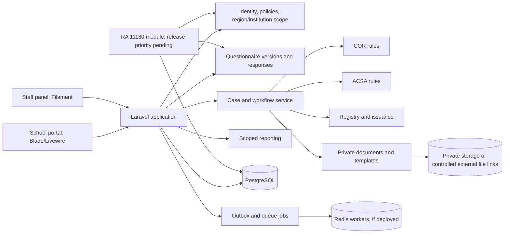

# OSDS Management Platform: technical specification and development roadmap

**Review draft — updated 13 October 2026.** This specification refines the [preliminary requirements and architecture report](./OSDS_REQUIREMENTS_ARCHITECTURE_REPORT.md) and incorporates findings from a [first partial transcript](<C:/Users/LocalUser.LAPTOP-MGEP8F46/.codex/attachments/2c93d49a-d3cd-44c3-9076-273efdd5bcdb/Pasted text.txt>) and an [overlapping second excerpt](<C:/Users/LocalUser.LAPTOP-MGEP8F46/.codex/attachments/10b1739a-2697-43a1-83cf-abee52dd4868/Pasted text.txt>). Both are machine-generated and incomplete. This is a build design for review, not a CHED policy or authorization to build or issue official records. No application code has been implemented.

## 1. Evidence, scope, and decision status

**Recorded intent:** COR and ACSA are initial case modules; five account types are provisionally supervisor-confirmed (Super User, Admin, OSDS, CHEDRO, SCHOOL); region-aware access, configurable forms and requirements, registry, document handling, audit, and reporting are requested. The supplied process image depicts five COR/ACSA steps totaling nine displayed days. The RA 11180 image presents proposed enhancements, while the partial meeting transcript calls RA 11180 reporting urgent. Release priority therefore requires an explicit decision. These are sources of requirements discovery, not final rules.

**Design decisions proposed here:** Laravel modular monolith; one PostgreSQL database; one account type per user with separate scoped action grants; immutable published form/template versions; separate case modules; an evidence-custody abstraction; transactional state changes and audit. Each decision is implementable but awaits architecture review.

**Unresolved stakeholder rules:** Exact COR and ACSA eligibility and documents; whether ACSA needs COR; national versus regional association jurisdiction; approval/signatory/delegation; registry timing and numbering; undertaking applicability; calendar-day/working-day SLA; form and template authority; evidence upload versus file-link custody; records retention; RA 11180 release priority and legacy-data disposition; and interim submission/cutover timing. No default in this specification grants official approval or certificate issuance.

### Supplied template inventory (candidate artifacts only)

The five downloaded templates were inspected as blank Office files. Their contents are evidence of possible data and document needs. **No template is assigned to COR or ACSA yet.** File wording must be checked against approved current versions before it becomes validation or policy.

| Candidate artifact | Observed fields and instructions | Review issue |
| --- | --- | --- |
| [CERTIFICATE OF UNDERTAKING.docx](<C:/Users/LocalUser.LAPTOP-MGEP8F46/Downloads/drive-download-20261013T032242Z-1-001/CERTIFICATE OF UNDERTAKING.docx>) | Athletic association name; undertakings about submitted documents, student-athlete protection, safety, insurance, updates, and monitoring; officers' signatures; date/place; notarial section | References a CHED memorandum “series of 2026” without a number. Legal wording, signatories, notarization, and applicability require process-owner review. |
| [INSURANCE COVERAGE.docx](<C:/Users/LocalUser.LAPTOP-MGEP8F46/Downloads/drive-download-20261013T032242Z-1-001/INSURANCE COVERAGE.docx>) | Institution, address, representative/designation; insurer, insurance type, period, athlete count, amount, policy number; benefits, covered activities, funding; insured athlete list with name, sport, optional policy number; instruction to attach extra list if needed | Clarify whether this is an application requirement, recurring update, or both; athlete personal data needs specific handling. |
| [LIST OF COACHES & TECHNICAL OFFICIALS_.xlsx](<C:/Users/LocalUser.LAPTOP-MGEP8F46/Downloads/drive-download-20261013T032242Z-1-001/LIST OF COACHES & TECHNICAL OFFICIALS_.xlsx>) | Association, date submitted; coach name, sport, affiliated HEI, employment status, position, email; add rows as needed | Instruction asks for contact number, but the visible header has no contact-number column. Title mentions technical officials while visible columns say “name of coach”; confirm whether officials need separate fields. |
| [LIST OF MEMBER HEIs.xlsx](<C:/Users/LocalUser.LAPTOP-MGEP8F46/Downloads/drive-download-20261013T032242Z-1-001/LIST OF MEMBER HEIs.xlsx>) | Association, submission date, preparer; HEI name/type/region and designated contact person's name, position, email, phone; add rows as needed | Confirm source of truth for HEI identity and whether member lists are snapshots or maintained registry data. |
| [SAP-Calendar of Activities Template.docx](<C:/Users/LocalUser.LAPTOP-MGEP8F46/Downloads/drive-download-20261013T032242Z-1-001/SAP-Calendar of Activities Template.docx>) | School year; activity/sport, expected participants, participating HEI or association, dates, venue/address, focal person/contact; prepared/submitted and authorized signature lines | Confirm what “SAP” means, the applicable module, whether activities are planned or approved, and whether schedule changes require a revision. |

**Artifact decision:** For each file, obtain the approving owner, approved version/date, module applicability, whether the completed file is uploaded, entered as structured data, or both, and whether signatures/notarization must remain on paper. Preserve originals and approved revisions; never silently convert a signed document into editable form data.

## 2. Stack assessment and implementation baseline

| Technology | Fit and use | Limit / alternative |
| --- | --- | --- |
| Laravel | HTTP routes, policies, validation, transactions, migrations, notifications, scheduled work, queues | Workflow and jurisdiction are application logic; framework conventions alone do not enforce either. |
| Filament | Staff panels for case queues, configuration review, registry lookup, reports, and permission administration | A panel is UI, not an access boundary. Every query, action, export, and download still needs server-side policy/scope checks. |
| Livewire + Blade + Tailwind | School-facing application flow and accessible server-rendered forms; Filament uses Livewire internally | Long and complex forms need deliberate save-draft, validation, performance, and accessibility testing. Treat Livewire action inputs as untrusted. |
| PostgreSQL | Referential integrity, partial/unique indexes, JSONB snapshots, transactional events, search; optional row-level security | RLS adds connection-context and job complexity; begin with explicit scoped repositories/policies and test cross-region denial, then add RLS as a reviewed defense layer. |
| Spatie Laravel Permission | Five role bundles and named action permissions | It does not encode case ownership, institution membership, or region scope. Keep those in domain tables and policies. Avoid Spatie Teams until a real tenant model is confirmed. |
| Private Laravel filesystem | Proposed baseline for private local/S3-compatible evidence and controlled downloads | The meeting also proposed individual external file links. Choose custody before intake implementation; a hybrid needs link verification, access control, version capture, and records-owner approval. Add malware scanning/quarantine for hosted files and keep Livewire temporary uploads private. |
| Redis + Laravel Queues | Notifications, document scans, rendering, exports, retries; use `after_commit` and idempotency | Redis is optional for first local prototype; production needs worker monitoring and durable failure handling. Queue jobs cannot be the sole record of official state changes. |
| Pest/PHPUnit | Unit, feature, policy, database, and workflow tests | Use PostgreSQL for database integration tests; SQLite would miss PostgreSQL constraints and JSONB behavior. |

**Proposed compatibility baseline:** PHP 8.3+, Laravel 13, Filament 5, matching Livewire 4 and Tailwind 4.1+, and a Spatie Laravel Permission release compatible with Laravel 13. Lock exact compatible versions in the future dependency files after CHED hosting and support constraints are checked. Laravel 13 requires PHP 8.3; Filament 5 supports Laravel 11.28+ and Tailwind 4.1+; Spatie lists Laravel 13 compatibility for its recent releases. [Laravel release notes](https://laravel.com/framework/docs/releases), [Filament installation](https://filamentphp.com/docs/5.x/introduction/installation), [Spatie prerequisites](https://spatie.be/docs/laravel-permission/v8/prerequisites).

**Alternative:** If the approved host cannot run PHP 8.3 or the baseline packages, choose a mutually compatible, supported Laravel/Filament/Spatie set before implementation; do not change the domain architecture. If approved certificate layouts cannot be reproduced reliably through Blade-to-PDF, use an approved document rendering service or DOCX template renderer behind a `DocumentRenderer` interface. Never let a rendering library determine official wording or signature validity. The meeting mentioned DigitalOcean as a possible host, not an approved deployment choice.

## 3. Modular monolith and contracts

One deployable Laravel app, one PostgreSQL database, private file storage, optional Redis workers. Recommended boundaries within `app/Domain`: `IdentityAccess`, `OrganizationsRegions`, `Questionnaires`, `CaseManagement`, `DocumentsTemplates`, `RegistryIssuance`, `AuditNotifications`, `Reporting`, `COR`, `ACSA`, and later `RA11180`. Filament resources and Livewire pages are adapters; domain services own state changes. Modules may use shared contracts, not each other's tables through ad hoc queries.

**Internal service contracts:** `CaseModule` supplies module code, allowed transitions, required application data, and validation hooks; `QuestionnairePublisher` validates and freezes a form; `ResponseRecorder` validates against a published version and saves a revision; `ScopeResolver` returns authorized region/organization identifiers; `DocumentStore` handles quarantine, scan status, and authorized retrieval; `DocumentRenderer` produces drafts; `RegistryService` assigns official identifiers only on an approved trigger; `AuditRecorder` writes an event in the same transaction as a state change. These are internal PHP interfaces, not public APIs. A future external API requires a separate contract and authorization review.

**Request path:** Authenticate → authorize action through Laravel policy/Spatie permission → resolve organization/region scope → validate published schema and module rule → transactionally write case state, response/evidence metadata, status event, and audit/outbox records → commit → queue notifications/rendering/scans or link checks → reauthorize download/link reveal or follow-up action. A queue worker acts as a service principal with explicit scope and audit identity. [Laravel authorization](https://laravel.com/framework/docs/13.x/authorization), [Laravel queues and commit behavior](https://laravel.com/framework/docs/13.x/queues).

**UI boundary:** Use a separate school portal and staff Filament panel. `canAccessPanel` gates panel entry; policies gate every resource/action. Staff panel navigation visibility is convenience only. The school portal must never expose staff actions even if a URL is guessed. Avoid implicit Filament tenancy because case jurisdiction can differ from a simple organization tenant; explicit scopes are easier to audit.

## 4. Database design

Use `bigint` identity primary keys internally, `uuid` public IDs for externally referenced cases and documents, `timestamptz` timestamps in UTC, and foreign keys. Avoid soft-deleting submitted cases, signed records, and audit events. For drafts, record explicit lifecycle state and retention outcome. Published configuration and submitted evidence are append-only or superseded by a new row. The table list below is a proposed physical design; policy-dependent fields remain nullable until approved, with transition services enforcing completeness at the relevant step.

### Identity, geography, and organizations

| Table | Key columns and relationships | Constraints / indexes |
| --- | --- | --- |
| `users` | `id`, `public_id`, `name`, `email`, password/IdP subject, `status`, MFA metadata, `last_login_at` | Unique normalized email and `public_id`; disabled users denied access. Account type is the assigned Spatie role, not a second field that can drift. |
| Spatie `roles`, `permissions`, `model_has_roles`, `role_has_permissions`, `model_has_permissions` | Five seeded account-type roles and action permissions on one `web` guard | Use package migrations and unique role/permission names; application service enforces exactly one active top-level role per user. Direct grants restricted and audited. No Spatie Teams in MVP. |
| `regions` | Stable CHED region code, name, active period | Unique code; no hard deletion when referenced. |
| `user_region_grants` | `user_id`, `region_id`, scope/action class, `starts_at`, `ends_at`, grantor, revoker | FK; indexed active grants by user/region; no overlapping active duplicate grant for same class. |
| `organizations` | `id`, `public_id`, type (`school`, `association`, other future type), name, approved identifier, address, primary region | Unique official identifier only when one exists; indexed normalized name for duplicate review, never auto-merge. |
| `organization_memberships` | Association organization, member school organization, effective dates, source document/revision | FK; prevent exact duplicate active membership; preserve history. Candidate only until templates are approved. |
| `user_organization_grants` | User, organization, representative role, verification status, effective dates, evidence document | FK; indexed active grants; a SCHOOL user sees only granted organizations/cases. |

`organizations` supports a school or an athletic association without pretending they are identical. The meeting suggests different regional/national association handling, but routing must await approval. The case's applicant organization and submitting user are separate. Historical organization name/address snapshots in the case prevent later profile edits changing an old submission. A SCHOOL-tier account may represent an association only if supervisors approve that mapping; the display name of the tier does not settle eligibility.

### Configuration and questionnaire engine

| Table | Key columns and relationships | Constraints / indexes |
| --- | --- | --- |
| `modules` | Unique code (`cor`, `acsa`, future), owner, enabled state | Unique immutable code. |
| `form_definitions` | Module FK or standalone category, key, audience, owner, draft state | Unique `(module_id, key)` when module-bound; owner required. |
| `form_versions` | Definition FK, version number, state (`draft`, `published`, `retired`), schema hash, publish actor/time, effective dates | Unique `(form_definition_id, version_no)`; immutable after publish; at most one active published version per definition/audience/effective interval. |
| `form_sections`, `form_questions` | Version FK, stable key, order, type, label/help, required flag, validation JSONB, options JSONB, condition JSONB | Unique question key per version; schema check on supported types; immutable when parent published. |
| `requirement_set_versions`, `document_requirements` | Module, version, publish state, ordered requirement key, accepted types/counts, condition JSONB | Unique module/version and key/version; published set immutable. Applicability to COR/ACSA requires approval. |
| `questionnaire_links` | Published form version, token hash, audience, created by, expiry, max uses, use count, revoked time | Unique token hash; indexed expiry/revocation; raw token never stored. |
| `response_sets` | Application nullable for standalone questionnaire, form version, respondent user/organization, revision, state, submitted time, answer snapshot/hash | Unique `(application_id, form_version_id, revision)` when case-bound; immutable once submitted. |
| `response_answers` | Response set, question key/FK, typed JSONB value, visibility/validation snapshot | Unique `(response_set_id, question_key)`; index selective reportable keys only; no indexing all free text by default. |

Publish-time validation rejects duplicate keys, unsupported field types/rules, invalid option references, cycles in conditional dependencies, conditions pointing to later/inaccessible questions, and unbounded file requirements. Draft edits do not alter published versions. Submitted answers always reference the exact published version.

### Cases, reviews, documents, and official records

| Table | Key columns and relationships | Constraints / indexes |
| --- | --- | --- |
| `applications` | `public_id`, module, applicant organization, submitter, owning region, current state, current revision, form/requirement version, submitted time, optimistic `lock_version` | Unique `public_id`; indexes `(owning_region_id, module_id, state, submitted_at)` and `(organization_id, module_id, submitted_at)`; region and organization snapshot columns. |
| `application_revisions` | Application, revision no., submitter, submitted time, data snapshot JSONB/hash, reason | Unique `(application_id, revision_no)`; immutable after submission. |
| `application_status_events` | Application, sequence, from/to state, actor, reason, occurred time, revision | Unique `(application_id, sequence)`; indexed case/time; append-only. Current state is a maintained projection, not the sole history. |
| `review_findings` | Application/revision, checklist item, reviewer, outcome, comment, reviewed time | Indexed case/revision; preserve findings across correction cycles. |
| `approval_decisions` | Application/revision, decision type/outcome, actor, authority/delegation reference, decision time, evidence | No decision without actor and authority reference where policy requires it; approved decision types to be defined by owner. |
| `documents` | `public_id`, case, requirement, uploader, custody mode (`hosted`/`external_link`), private storage key or encrypted file URL, checksum if captured, MIME, size, scan/link-check status, version, supersedes, classification, timestamps | Unique public ID; storage key unique when hosted; index case/requirement/version and verification state. External URLs must point to individual files; never treat a folder URL as evidence or place a token-bearing URL in logs. Schema supports either mode, but enabling a mode requires records/security approval. |
| `template_versions`, `generated_documents` | Module/document kind, approved version, source hash, effective dates; generated case artifact, input snapshot/hash, renderer version, draft/issued marker | Unique template kind/version; generated artifact immutable; draft marker cannot be changed to issued by rendering job alone. |
| `registry_entries` | Application, registry number, region, created actor/time, status, recognition visibility fields | Unique registry number once numbering rules exist; partial unique active entry per application; index status and approved organization search key for nationwide lookup. Trigger and visible fields are unresolved. |
| `certificates` | Registry entry, type, certificate number, generated artifact, signatory, signed evidence, issued time, delivery evidence, status, replaces certificate | Unique certificate number when assigned; issuance requires approved service transition and evidence according to confirmed policy. |
| `audit_events`, `outbox_events` | Actor/service, action, resource, region, request ID, time, safe metadata; outbox event type/payload/delivery state | Append-only audit with indexed resource/time and actor/time; unique outbox event ID for idempotent processing. No secrets, raw link tokens, or document contents. |

**Candidate template-derived data:** If owners approve structured capture, add `insurance_coverages` plus insured-athlete child records, `activity_schedules` plus participants, and `organization_personnel` for coaches/officials. `organization_memberships` covers member HEIs. Keep each as a versioned application snapshot or linked current registry data according to process-owner decision. Do not create these tables merely because a blank file contains fields; uploaded signed files can remain primary evidence.

**PostgreSQL integrity:** Foreign keys on all relationships; `CHECK` constraints for nonnegative counts/amounts, valid time ranges, and exactly one evidence locator matching custody mode; partial unique indexes on non-null official numbers and active grants; `ON DELETE RESTRICT` for evidence; use `SELECT ... FOR UPDATE` and one transaction for case transitions and number assignment. Use JSONB for versioned form schema/answer values, not for identity, jurisdiction, official numbers, or core state. Index only defined reporting/filter paths. Treat full-text or fuzzy search as a later measured need.

**Migration order:** (1) users/auth and Spatie package tables; (2) regions, organizations, user scope grants; (3) audit/outbox infrastructure; (4) modules and versioned forms/requirements; (5) applications, revisions, responses, status and review history; (6) evidence metadata and template versions; (7) decisions, registry and certificates after process rules are approved; (8) reporting indexes/views; (9) optional template-derived structured tables and RA 11180 tables when its approved release phase begins. Seed roles/action names separately from policy-dependent grant assignments. Use forward-only reviewed migrations and a rollback/restore rehearsal before production.

## 5. Five-account access model

Spatie roles are **labels and action bundles**. Laravel policies combine permission, active account, region grant, applicant organization grant, case state, and any required delegation. No automatic inheritance from the displayed Super User → Admin → OSDS → CHEDRO → SCHOOL order. One primary top-level role per user is the proposed baseline; extra duties are explicit grants, not an extra top-level account type.

**Proposed matrix for review:** `P` = proposed allow in assigned scope; `C` = proposed capability only after specific configuration/delegation; `—` = deny. This is a technical starting point, not an approved permission grant.

| Action | Super User | Admin | OSDS | CHEDRO | SCHOOL |
| --- | :---: | :---: | :---: | :---: | :---: |
| Manage platform settings and account types | P | C | — | — | — |
| Provision/deactivate users and scope grants | P | P | C | C | — |
| Draft/publish module forms, requirements, templates | C | C | C | — | — |
| View national case summaries | C | C | P | — | — |
| View case details | C | C | C | P, assigned region | P, granted organization |
| Submit or correct own application | — | — | — | — | P |
| Screen and request correction | — | — | C | P, assigned region | — |
| Validate and record findings | — | — | C | P, assigned region | — |
| Register applicant / assign official number | — | — | C | C, assigned region | — |
| Record approval/signature/issuance | — | — | C | C, delegated case | — |
| Export case-level data / audit history | C | C | C | C, assigned region | — |
| View own submitted documents and released outputs | — | — | — | — | P |

`C` does not become effective until an action-specific permission and any delegation are approved. Super User is not a universal case reader or signatory. Proposed OSDS national summary access is distinct from individual personal-data access. CHEDRO's internal duties can be separate permissions assigned to staff, while retaining one CHEDRO account type. School representation is verified per organization, not inferred from email domain.

**Supervisor decisions:** account creation chain; who can grant/revoke regional and school/association representation; whether Admin and OSDS have national detail access; whether one user can hold multiple account types; CHEDRO task separation; publication authority; export approval; and whether Super User has emergency case access. The meeting discussed enrollment through school athletic directors/sports coordinators and association secretariats, but did not approve an identity-proofing method. **Process-owner decisions:** formal approver/signatory/delegation and issuance rights. Approval must never be inferred from a role name.

## 6. Dynamic questionnaire specification

1. **Authoring:** Authorized editor creates a draft definition and sections/questions. MVP types: short/long text, integer/decimal, date, single/multiple choice, yes/no, email, and document upload requirement. Repeating groups and calculated values require a separately reviewed extension. Labels, help, options, order, limits, and simple validation are configuration data.
2. **Conditions:** Support declarative `all`/`any` comparisons to prior answers (`equals`, `in`, `is_empty`). No arbitrary PHP/JavaScript or cross-case expressions. Preview evaluates the same rules as submission. Hidden question answers are ignored on the server; required validation applies only to visible questions. Publish rejects dependency cycles and invalid references.
3. **Validation:** Validate both client presentation and server submission against the exact published version. Apply type/range/length/option constraints, document rules, and module-specific business validation. A form cannot itself authorize a case transition or official decision.
4. **Publication:** Draft → reviewed/published → retired. Publishing creates an immutable numbered version with approver, time, and schema hash. Editing a published form clones a draft; old applications keep the old version. Rollback means republishing a new version derived from an older one, never mutating history.
5. **Links:** Shareable links point to a published form version. Use high-entropy bearer tokens stored only as hashes, expiry/revocation, optional maximum use, rate limits, and an approved audience policy. A link grants access to the questionnaire only, never to case details, uploaded documents, or certificate status. Whether anonymous responses are allowed is unresolved; default is authenticated SCHOOL use for case-bound forms.
6. **Storage:** Save drafts separately from immutable submitted response revisions. Retain question key/type/version with each answer and a submission snapshot/hash. Correction creates a new case/response revision; preserve prior values and audit who changed them. Avoid moving files directly from temporary uploads into trusted evidence until scanning completes.
7. **Safety/usability:** Autosave draft with conflict detection, accessible labels/errors, explicit submit confirmation, session timeout recovery, and no user-controlled HTML/script execution. Test conditional visibility and server tampering. Filament can author forms; school-facing renderer should be a dedicated Livewire component using the same schema validator.

## 7. Preliminary COR and ACSA workflows

Both modules use a shared case service and **separate rule/configuration classes**. The supplied graphic presents a combined path, so common steps below are observed process candidates. Distinct eligibility, checklist, undertaking, signature, and issuance rules must be approved per module. The displayed 1 + 5 + 1 + 1 + 1 days are a reference for discovery, not an encoded SLA.

| Stage | COR preliminary path | ACSA preliminary path | System boundary |
| --- | --- | --- | --- |
| Draft and submission | School/authorized organization completes COR versioned form and approved requirements | School/authorized organization completes ACSA versioned form and activity-specific data if approved | Save draft; on submission freeze revision and issue internal case reference. No COR prerequisite enforced. |
| Receipt and screening | CHEDRO of assigned region checks completeness against COR checklist | CHEDRO checks ACSA checklist independently | Record receipt, findings, missing items, and reviewer. System may flag gaps, but human determines disposition. |
| Correction | Applicant submits a new revision when requested | Same, under ACSA rules | Preserve old answers/files/findings; require reviewer-controlled return to screening. |
| Validation | CHEDRO validates COR evidence and records outcome | CHEDRO validates ACSA evidence and records outcome | No automatic approval based on complete fields. Exact approval authority unresolved. |
| Registry | CHEDRO registers applicant/case at approved trigger | CHEDRO registers ACSA applicant/case at approved trigger | Registry trigger, uniqueness, and number format are blocked pending policy. |
| Certificate draft | Render COR draft from approved COR template | Render ACSA draft from approved ACSA template | Draft/watermark; render job cannot sign or issue. Verify fields against approved templates. |
| Signature and schedule | Route draft for authorized signature; email undertaking/issuance schedule if required | Same only if ACSA rules require those steps | Record delegation, signature evidence, scheduling and notification delivery. No assumed digital signature. |
| Undertaking and issuance | Record signed undertaking if required; issue signed COR with receipt evidence | Record ACSA-specific undertaking if required; issue signed ACSA with receipt evidence | A separate authorized action records issuance; immutable certificate and delivery events. |

**Candidate states**, to be approved before coding transitions: `draft`, `submitted`, `screening`, `correction_requested`, `under_validation`, `validated`, `registry_pending`, `document_prepared`, `awaiting_signature`, `ready_for_issuance`, `issued`, `rejected`, `withdrawn`, `cancelled`. No state alone proves legal approval. Define allowed actor, guard, evidence, notification, and audit event for each transition in separate COR and ACSA transition tables/configuration. Reopen, reassignment, duplicate, replacement, revocation, and rejection paths remain process gates.

## 8. RA 11180 module boundary, legacy system, and release priority

The supplied image proposes HEI report submission/status, CHEDRO regional validation/correction, Central Office consolidation, anomaly flags, and dashboards. Year-specific portal links were supplied but not inspected. A participant described RA 11180 reporting as urgent. **A signed requirements analysis must decide whether it is first release, parallel, or later.** Keep it a separate bounded module regardless of release timing. It may reuse users, school organizations, regions, questionnaire versions, evidence, audit, and scoped reporting; it must own `reporting_cycles`, `hei_report_submissions`, revisions, validation findings, and anomaly flags. Academic-year cycle, RSC meaning/role, dataset, and duplicate criteria require discovery. Do not add RA 11180 tables merely to future-proof the COR/ACSA schema.

The second excerpt describes an **existing OPRKM-hosted RA 11180 collection system** with region-level access, region-by-region exports, weak central consolidation/status visibility, downloaded templates of approximately eight sheets, and user-reported errors. These descriptions require direct inspection; the system's actual database, data ownership, code, and export quality are not yet known. Before a replacement is designed, inventory its schema/screens, roles, sample anonymized exports, submission counts by academic year, support owner, and whether the questionnaire is being revised. Compare three disposition options in the signed scope: (a) clean and import validated history, (b) archive old records read-only with a new system for future cycles, or (c) maintain a governed link/reference to legacy data. Do not silently discard history or import unverified spreadsheet formulas.

The meeting also suggests a **transitory Google Form/manual route** while the platform is developed. Treat it as an external process until approved: define an interim case identifier, custody/owner, data export format, reconciliation procedure, and duplicate check if those records will later enter the platform. A mentioned January deadline and August–December 2026 development window are planning statements, not confirmed service commitments.

## 9. Phased backlog and acceptance gates

Each item is independently demonstrable or testable. Phase 0 is required before policy-dependent case behavior; architecture/security foundations can be prototyped with synthetic data after technical approval.

| ID | Task | Acceptance criterion |
| --- | --- | --- |
| D1 | Inventory Google Forms, certificate Slides, Apps Script, downloadable files, and five local templates with owners/versions | Artifact register identifies current approved version, module applicability, data fields, outputs, and unresolved discrepancies; no live responses copied to development. |
| D2 | Approve signed user requirements analysis and separate COR/ACSA process and permission matrices | Named process owners sign off transitions, requirements, regional/national association routing, registry/signature/issuance triggers, and exceptions; RA 11180 release priority is explicit. |
| D3 | Decide evidence custody and external launch controls | Records/IT/security owners approve hosted files, individual file links, or hybrid; identify physical-original receipt rules and actual security assessment/deployment gate. |
| D4 | Scope RA 11180 independently if selected for first release or parallel work | Owner approves report dataset, cycle, HEI/CHEDRO/Central Office actions, prior-portal migration, and a separately testable backlog. |
| D5 | Inspect existing RA 11180 system and eight-sheet template set | Read-only inventory records actual screens, role scopes, source data/export formats, known defects, submission volume, and code/support ownership; migration alternatives are compared. |
| D6 | Confirm interim intake and cutover | Owner approves whether Google Form/manual submissions continue, how they are uniquely identified and reconciled, and the actual deadline/cutover date. |
| F1 | Scaffold compatible Laravel/Filament/Livewire/Pest stack and PostgreSQL environment | Fresh install, migration, and smoke test pass with pinned compatible versions and documented local setup. |
| F2 | Create identity, five roles, permissions, region and organization grants | Seed is repeatable; disabled users and wrong-region/wrong-organization users are denied in automated tests. |
| F3 | Build audit/outbox transaction helper and authorization policies | A case mutation and audit event commit together; a rollback writes neither; queued side effects start after commit. |
| Q1 | Add form and requirement version tables/editor with draft preview | Editor can create supported field types; invalid conditions/duplicate keys are rejected. |
| Q2 | Publish and render immutable questionnaire versions | Published schema cannot change; a school response validates against the version it opened; old response remains readable after new publication. |
| Q3 | Add authenticated shareable link flow, then optional anonymous mode only if approved | Expired/revoked/overused link is denied; link never opens other case data. |
| C1 | Add case/revision/status schema and school draft/submission UI | School can submit a valid case and view only its authorized organization cases; revision snapshot and reference persist. |
| C2 | Implement approved evidence custody mode with authorized retrieval | Hosted mode: unscanned or wrong-region file cannot be downloaded and checksum/version persist. External-link mode: reject folder links, check file access/version, restrict link reveal, and record broken/changed evidence. Track physical originals if required. |
| C3 | Add CHEDRO queue, screening, findings, correction loop | Assigned-region reviewer requests correction; school resubmits a new revision; previous evidence remains accessible to authorized reviewers. |
| C4 | Add COR module rules/config and approved transition guards | COR case passes approved acceptance examples; unauthorized transitions and ACSA-only fields are rejected. |
| C5 | Add ACSA module rules/config independently | ACSA case passes its own acceptance examples without an assumed COR prerequisite. |
| I1 | Add registry and number assignment after policy sign-off | Concurrent requests cannot duplicate a number; no record is created before approved trigger. |
| I2 | Add versioned template rendering and signature evidence | Correct approved COR/ACSA draft is generated with source/input hash; draft cannot be marked issued by renderer. |
| I3 | Add authorized issuance and delivery recording | Only delegated actor can issue under approved prerequisites; signed evidence, timestamp, recipient, and audit event are preserved. |
| O1 | Add scoped dashboards, exports, and operational monitoring | Region totals reconcile to cases; cross-region data excluded; export permission and audit recorded. |
| O1a | Add approved nationwide recognition lookup | Authorized HEI can find only approved registry fields and current status across regions; no case documents or personal contact data leak. |
| O2 | Pilot, restore drill, accessibility/security review, rollout checklist | Process owners accept test cases; backup restore works; critical vulnerabilities and access leaks are resolved before wider rollout. |
| O3 | Test school-scale use and handover | Load test uses measured workload plus a documented approximately 3,000-school planning scenario; queue/search/submission targets are agreed and met; runbook, owner, and support path are accepted. |

**Testing baseline:** Pest/PHPUnit unit tests for conditions and module guards; PostgreSQL integration tests for constraints, transactions, concurrency, revisions, and numbering; Livewire/Filament feature tests for each role/scope; document upload/download and malware-state tests; template golden-file checks against approved samples; accessibility and manual business walkthroughs. Prioritize denial cases: forged Livewire action parameters, guessed case IDs, cross-region exports, stale links, changed published forms, double-click issuance, and failed queue retries. [Livewire security guidance](https://livewire.laravel.com/docs/4.x/security), [Livewire upload guidance](https://livewire.laravel.com/docs/4.x/uploads).

## 10. Dependencies and release blockers

1. **Process authority:** Obtain a signed user requirements analysis and approved, separate COR/ACSA procedure, checklists, eligibility, correction/rejection paths, regional/national association jurisdiction, registry trigger, official numbering, signatory/delegation, undertaking, and issuance evidence. Do not implement policy-dependent transition guards or certificate issuance before this.
2. **Template authority:** Resolve applicability and approved versions of five local templates and linked certificate presentations. Correct the incomplete 2026 memorandum reference and coaches contact-number mismatch with the document owner, not in code by guesswork.
3. **Identity and jurisdiction:** Approve the five-role permission matrix, regional ownership/transfer rules, school representation proof, national detail/export access, and privileged support procedure before real data is loaded.
4. **Privacy and records:** Classify athlete and contact data; define limited nationwide recognition lookup fields; set retention/disposal and access review rules; choose hosted files, individual external file links, or hybrid custody; approve link change/access controls, physical-original tracking, backup encryption, malware service, and breach response. Signatures/notarial evidence need records-owner direction.
5. **Infrastructure and security gate:** Confirm PHP/PostgreSQL/Redis/storage availability, mail delivery, queue-worker operation, backup/restore and maintenance owners, deployment environment, and version compatibility. The meeting mentioned DigitalOcean and external-facing VAPT clearance; the excerpts inconsistently transcribe its authority as “DICT” and “ICT.” IT/security must verify the actual approver, scope, and evidence before release. Queue, document-scan, and external-link failures must surface in an operator queue and never silently advance a case.
6. **SLA, capacity, and RA 11180:** Confirm the nine-day clock before displaying deadline promises. Validate the stated approximately 3,000-school planning scale and simultaneous usage through real counts and load testing. Decide RA 11180 release priority, existing-system data disposition, interim intake, owner, and dataset in the signed requirements analysis; keep its module boundary separate from COR/ACSA.

The next review deliverables are an approved artifact and legacy-system inventory, signed user requirements analysis with RA 11180 release priority and migration/cutover decision, separate COR/ACSA transition matrices, a five-role action/scope matrix, an evidence-custody decision, and an accepted physical schema. These are gates for coding policy-dependent features, not claims that the underlying policy is already known.
