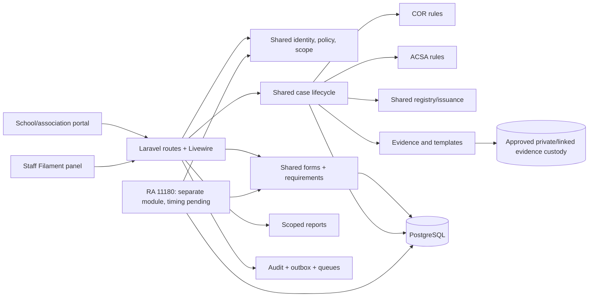

# OSDS modular monolith architecture

**Phase 0 review draft.** See [requirements](./requirements.md), [database design](./database-design.md), and [open decisions](./assumptions-and-open-questions.md). No production architecture is approved yet.

## Environment assessment, 13 October 2026

The workspace contains two Markdown reports and no initialized Laravel project or Git repository. Command checks on this Windows host found Git `2.56.0.windows.2`; `php`, `composer`, `node`, `npm`, `psql`, and `pg_config` were **not on PATH**. This does not prove that server or database software is absent elsewhere. Phase 1 needs a verified PHP runtime, Composer, Node/npm, reachable PostgreSQL, and an initialized Git repository. No software was installed.

## Proposed supported stack

Use PHP 8.3+, Laravel 13, Filament 5, Livewire 4, Blade, Tailwind 4.1+, PostgreSQL, Laravel Policies, a Laravel-13-compatible Spatie Laravel Permission release, private Laravel filesystem, and Pest or PHPUnit. Redis and queue workers are introduced when asynchronous scans, rendering, notifications, or exports are needed; a database queue is possible for a small initial environment, with production durability/operations reviewed. Pin tested compatible versions in Phase 1. [Laravel release support](https://laravel.com/framework/docs/releases), [Filament 5 prerequisites](https://filamentphp.com/docs/5.x/introduction/installation), [Spatie compatibility](https://spatie.be/docs/laravel-permission/v8/prerequisites).

Filament is for staff administration and queues; Blade/Livewire is for the applicant portal. Filament visibility is not authorization. The preferred stack needs no React, Inertia, microservices, or Docker. Docker is optional for reproducible local development if the team later needs it; deployment topology remains subject to approved hosting.

## Module map

## Project structure and dependency rules

Proposed `app/Domain/{IdentityAccess,OrganizationsRegions,Questionnaires,CaseManagement,DocumentsTemplates,RegistryIssuance,AuditNotifications,Reporting,COR,ACSA}`. Add `RA11180` only in its approved release. Put Eloquent models near their domain; put cross-domain contracts in `app/Contracts` only when used by two or more modules. Place Filament resources in `app/Filament`, applicant Livewire components in `app/Livewire`, HTTP controllers in `app/Http/Controllers`, policies in `app/Policies`, migrations in `database/migrations`, and tests in `tests/{Unit,Feature}` with domain grouping.

- UI adapters call domain actions/services; they do not directly write official state through ad hoc model saves.
- COR and ACSA depend on shared services, never on each other's private rules. RA 11180 may reuse shared services but owns its cycle, report, and validation logic.
- Policies combine named Spatie permissions with active user, region, organization representation, record ownership/state, and delegation. Every route, Filament action/query, Livewire action, export, and document retrieval uses the same checks.
- Case transitions write current state, immutable status event, audit event, and outbox event in one PostgreSQL transaction. Queue work begins after commit and is idempotent. Rendering produces a draft; a separate authorized transition records signing and issuance. [Laravel authorization](https://laravel.com/framework/docs/13.x/authorization), [queue commit behavior](https://laravel.com/framework/docs/13.x/queues).
- `EvidenceStore` hides approved hosted/link/hybrid custody. Do not select file-link mode solely for storage savings; it needs durable access, version, and records controls. Physical-original receipt is separate metadata when required.

## Interface conventions

No public API is in Phase 0 scope. Internal actions accept validated DTOs and actor/context, return a result with case ID/new state, and throw typed domain exceptions for invalid transition, forbidden scope, stale revision, or unavailable evidence. Controllers/Livewire translate these to user-safe messages; logs use a correlation ID and avoid raw personal data. Jobs receive stable IDs, reload current records, and recheck service authority. Database and filesystem failures must not produce an issued certificate or success notice.

## Operational boundaries

PostgreSQL is the transactional source of truth. Private files live on an approved disk; externally linked evidence is enabled only after records/security approval. Search starts with indexed PostgreSQL. Queue workers and scheduler are supervised processes if asynchronous work is enabled. Report queries use the same scope resolver as case screens. The external launch gate, host, backup owner, and reported VAPT clearance authority require confirmation; the partial transcripts differ on “DICT” versus “ICT.”
