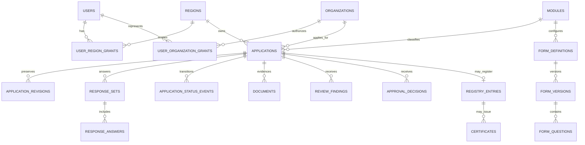

# Preliminary PostgreSQL database design

**Phase 0 review draft.** Detailed rationale is in the [technical specification](../OSDS_TECHNICAL_SPECIFICATION.md). This schema is preliminary; policy-dependent constraints are identified below. Use `bigint` primary keys internally, UUID public identifiers, `timestamptz` in UTC, foreign keys, and PostgreSQL integration tests.

## Relationship map

## Tables, keys, constraints, indexes

| Group | Tables and relationships | Required constraints and access indexes |
| --- | --- | --- |
| Identity | `users`; Spatie `roles`, `permissions`, model/role/permission pivots | Unique normalized email and user public UUID; active/disabled state. Five top-level roles on one guard; application service enforces one primary role. No role hierarchy. |
| Region grants | `regions`; `user_region_grants(user_id, region_id, action_scope, starts_at, ends_at, grantor_id)` | Unique region code; FK; check end > start; indexed active grants by user/region; reject overlapping identical grants. |
| Organizations | `organizations(type, name, official_id?, primary_region_id?)`; `user_organization_grants`; optional `organization_memberships` | Type distinguishes school/association; partial unique official ID; FK, effective date checks, active grant indexes. Preserve organization snapshot in applications. |
| Modules/forms | `modules`; `form_definitions`; `form_versions`; `form_sections`; `form_questions` | Unique module code, form key per module, `(form_id, version_no)`, and question key per version; immutable published versions; validate condition graph before publish. |
| Requirements/links | `requirement_set_versions`; `document_requirements`; `questionnaire_links` | Unique module/version and requirement key/version; link token hash unique, expiry/revocation indexed; no raw bearer token stored. |
| Applications | `applications(public_id, module_id, organization_id, submitter_id, owning_region_id, state, revision, lock_version)`; `application_revisions` | FKs; unique public ID and `(application_id, revision_no)`; indexes `(region,module,state,submitted_at)` and `(organization,module,submitted_at)`. Submitted revisions append-only. |
| Responses | `response_sets(application_id?, form_version_id, revision, state)`; `response_answers(response_set_id, question_key, value_jsonb)` | Unique answer key per set and case/form/revision; immutable submitted sets. Index reportable answer keys selectively. |
| Workflow | `application_status_events`; `review_findings`; `approval_decisions` | Unique event sequence per case; append-only; indexed case/revision/time and actor/time. Approval actor/delegation evidence required once formal rule approved. |
| Evidence | `documents(application_id, requirement_id?, custody_mode, storage_key?, encrypted_file_url?, scan_or_link_status, checksum?, version, supersedes_id?)` | Exactly one locator for selected mode; unique public ID/storage key; index case/requirement/version/status; no folder links. Restrict evidence deletion. |
| Output | `template_versions`; `generated_documents`; `registry_entries`; `certificates` | Unique template kind/version and official number when assigned; partial unique active registry entry per case; certificate replacement links. Issuance trigger and number pattern await approval. |
| Operations | `audit_events`; `outbox_events` | Append-only audit indexed by resource/time and actor/time; unique outbox ID and idempotent delivery status. Safe metadata only. |

**Template-derived candidates:** `insurance_coverages` and insured-athlete details, `organization_personnel`, `organization_memberships`, and `activity_schedules` are added only if owners approve structured entry. Blank templates do not establish required database fields or COR/ACSA applicability.

**RA 11180 boundary:** Its future/parallel release owns `reporting_cycles`, `hei_report_submissions`, report revisions, validation findings, and anomaly flags. No certificate FK or COR/ACSA state is reused for report submissions. Existing OPRKM records need inventory and a signed import/archive/reference decision.

## Versioning and transaction rules

Published forms, questions, requirements, templates, and workflow definitions are immutable. Editing clones a draft and publishing creates a new version. Submitted application/response revisions, uploaded-file versions, status events, reviews, decisions, registry and certificate events, and audit events remain historical. Corrections supersede; they do not overwrite. Retention and disposal follow an approved schedule, not indefinite storage by default.

Use one transaction with row lock/optimistic version check for transitions and official number assignment. Write audit/outbox in that transaction. Use `CHECK` for valid ranges and custody mode, FK and partial unique indexes for official identifiers, `ON DELETE RESTRICT` for evidence. Keep identity, jurisdiction, numbers, and state relational; use JSONB for versioned question configuration/answers. No SQLite substitute for schema tests.

## Migration dependencies

1. Users/auth + Spatie tables; regions, organizations, grants.
2. Audit and outbox infrastructure; modules and versioned forms/requirements.
3. Applications, revisions, responses, status and review history.
4. Evidence and templates.
5. Decisions, registry, and certificates after process sign-off.
6. Reporting indexes/views and approved structured-template or RA 11180 tables in their authorized phase.

Seed role and permission **names**, never production users/passwords or speculative approval grants. Review forward migrations and rehearse restore before production.
